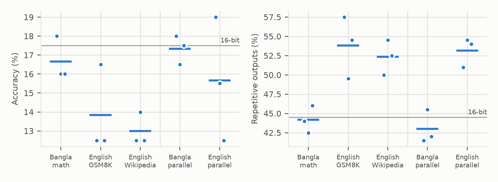
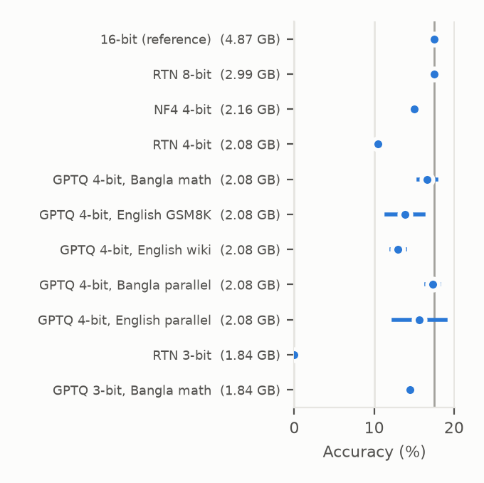
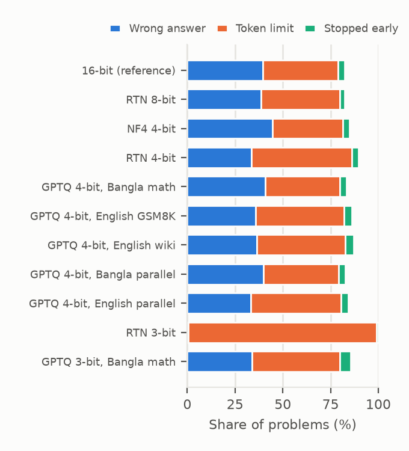

# Calibration Language Changes How Quantized Models Fail

**Post-training quantization of a small Bangla math LLM.** Code, model outputs and paper for a study of how weight quantization, and the language of its calibration data, affect [Gemma-2 2B fine-tuned for Bangla math](https://huggingface.co/ajoysr/bangla-math-gemma).

**Authors:** Ajoy Sarker, Shreya Nag Riya (Department of CSE, Jahangirnagar University)

📄 **Paper:** [paper/paper_Sarker_Riya.pdf](paper/paper_Sarker_Riya.pdf) · anonymous submission version: [paper/paper_anonymous_submission.pdf](paper/paper_anonymous_submission.pdf)

## Key findings

On 200 held-out Bangla math problems (paired bootstrap tests, Holm-corrected):

1. **8-bit is free.** RTN 8-bit makes the model 39% smaller with identical accuracy (17.5%).
2. **The method matters more than the bit width.** At 4 bits, GPTQ beats plain rounding (RTN) by +6.2 pp (p = 0.007). At 3 bits, RTN solves nothing while GPTQ keeps 14.5% (+14.5 pp, p < 0.001).
3. **Calibration language changes failures, not accuracy.** Calibrating GPTQ on Bangla instead of English does not significantly change accuracy, but English calibration makes outputs fall into repetition loops about 10 pp more often, even when both calibration sets contain **the same problems** (−10.2 pp, p < 0.001). Changing only the domain (English math vs. English Wikipedia) has no effect.
4. **Quantized models repeat; they do not drift.** 82–99% of unfinished outputs are repetition loops; at most 0.5% of outputs switch away from Bangla.
5. **Accuracy hides churn.** Even 8-bit RTN, with unchanged accuracy, fails 23% of the problems the 16-bit model solved. Numerical noise alone accounts for 3%.



## What was compared

| Method | Bits | Calibration |
|---|---|---|
| 16-bit | 16 | – (reference) |
| RTN | 8, 4, 3 | none (round to nearest, groups of 128) |
| NF4 | 4 | none (QLoRA's 4-bit format) |
| GPTQ | 4, 3 | five sets, 3 seeds each (see below) |

| Calibration set | Language | Content |
|---|---|---|
| Bangla math | Bangla | training problems |
| English GSM8K | English | grade-school math |
| English Wikipedia | English | WikiText-2, the common default |
| Bangla parallel | Bangla | 128 matched problems |
| English parallel | English | the **same** problems in their original English ([NuminaMath-CoT](https://huggingface.co/datasets/AI-MO/NuminaMath-CoT)) |

The Bangla dataset ([`hamim-87/Ashrafur_bangla_math`](https://huggingface.co/datasets/hamim-87/Ashrafur_bangla_math)) is a translation of NuminaMath-CoT in a different row order; `src/match_english.py` recovers the English original of each problem from its numbers and final answer.

Quantization is **simulated**: weights are rounded and stored back in 16-bit, so accuracy is exact but speed is not measured. This lets every method run on the same Apple Silicon machine.

## Results

| Method | Seeds | Bits/weight | Size (GB) | Accuracy (%) | Δ vs 16-bit, pp [95% CI] | Lost / gained (%) |
|---|---|---|---|---|---|---|
| 16-bit (reference) | 1 | 16.00 | 4.87 | 17.5 | – | – |
| RTN 8-bit | 1 | 8.01 | 2.99 | 17.5 | +0.0 [−4.0, +4.0] | 23 / 5 |
| NF4 4-bit | 1 | 4.50 | 2.16 | 15.0 | −2.5 [−8.0, +3.0] | 51 / 8 |
| RTN 4-bit | 1 | 4.16 | 2.08 | 10.5 | −7.0 [−12.5, −1.5] | 66 / 5 |
| GPTQ 4-bit, Bangla math | 3 | 4.16 | 2.08 | 16.7 ± 1.2 | −0.8 [−5.2, +3.3] | 45 / 8 |
| GPTQ 4-bit, English GSM8K | 3 | 4.16 | 2.08 | 13.8 ± 2.3 | −3.7 [−8.5, +1.0] | 59 / 8 |
| GPTQ 4-bit, English Wikipedia | 3 | 4.16 | 2.08 | 13.0 ± 0.9 | −4.5 [−9.2, 0.0] | 58 / 7 |
| GPTQ 4-bit, Bangla parallel | 3 | 4.16 | 2.08 | 17.3 ± 0.8 | −0.2 [−4.3, +4.0] | 42 / 9 |
| GPTQ 4-bit, English parallel | 3 | 4.16 | 2.08 | 15.7 ± 3.3 | −1.8 [−6.7, +3.0] | 57 / 10 |
| RTN 3-bit | 1 | 3.15 | 1.84 | 0.0 | **−17.5** [−23.0, −12.5] | 100 / 0 |
| GPTQ 3-bit, Bangla math | 1 | 3.15 | 1.84 | 14.5 | −3.0 [−8.5, +2.5] | 54 / 8 |

Bold = significant after Holm correction over the ten comparisons with 16-bit. Full tables, failure types and every paired test: [results/summary.md](results/summary.md).

<p>
  
  
</p>

## Repository layout

```
src/
  common.py           prompt format, data splits, calibration sets, answer extraction and scoring
  merge_lora.py       merge the LoRA adapter into the 16-bit base model
  simquant.py         simulated RTN, NF4 and GPTQ (GPTQ follows the reference implementation)
  simulate.py         quantize in memory and evaluate one configuration (resumable)
  match_english.py    match Bangla problems to their English NuminaMath-CoT originals
  fertility.py        tokens per word, Bangla vs English
  report.py           re-scoring, paired bootstrap + Holm, error analysis, figures, LaTeX tables
  train_lora.py       (optional) retrain the adapter with Unsloth
  evaluate.py, quantize_gptq.py   (optional) real-kernel CUDA path; not used for the paper
tests/test_scoring.py answer-matching tests (no GPU needed)
results/              per-problem outputs (*.jsonl), summaries (*.json), figures, summary.md
paper/                ACL-format paper (main.tex), build.sh, generated tables in paper/tables/
run_sim.sh            main experiment (15 configurations)
run_parallel.sh       parallel-calibration experiment (6 configurations)
progress.sh           show progress of a running experiment
```

## Reproducing

Requires Python 3.11 and about 16 GB of RAM. Tested on an Apple M1 Pro; also runs on CUDA or CPU.

```bash
python3.11 -m venv .venv
.venv/bin/pip install -r requirements.txt
export HF_HUB_DISABLE_XET=1          # avoids stalled downloads on some networks

# Rebuild every table and figure from the saved outputs (minutes)
.venv/bin/python src/report.py

# Rerun the experiments from scratch (about 15 h + 7 h on an M1 Pro; resumable)
bash run_sim.sh
bash run_parallel.sh
bash progress.sh                       # check progress at any time

# Tests and paper
.venv/bin/python -m pytest tests       # or: .venv/bin/python tests/test_scoring.py
bash paper/build.sh                    # builds both PDFs
```

The first run downloads the base model (about 5 GB), the adapter, the Bangla dataset (2.2 GB) and NuminaMath-CoT (1.2 GB).

**Evaluation details.** 200 held-out problems (dataset rows never used in training) with an automatically checkable answer and a reference solution of at most 384 tokens; greedy decoding up to 768 tokens. A problem is solved if the last `\boxed{}` answer matches the reference after normalization (Bangla digits, LaTeX formatting, units, numeric tolerance, choice letters matched to option values). All outputs are re-scored with the same rules by `report.py`.

## Limitations

One model, one machine-translated dataset, and 200 test problems drawn from the easier third of the data, so accuracy differences of a few points cannot be confirmed. The repetition analysis is secondary: the metric was defined after observing that unfinished outputs were loops. Quantization is simulated, so speed is not measured. One of the 24 GPTQ runs was resumed after re-quantizing with the same seed. See the paper's Limitations section for details.
